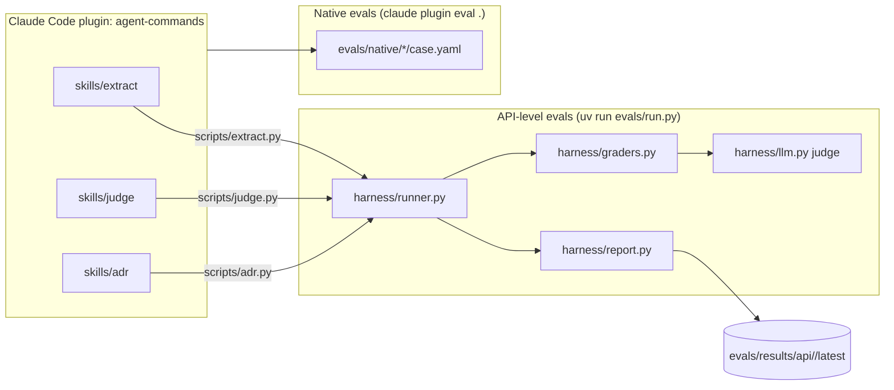

# Architecture

## Repository topology



## One eval attempt

```mermaid
sequenceDiagram
  participant H as harness.runner
  participant S as skills/<skill>/scripts/<skill>.py
  participant C as Claude API
  participant G as graders
  H->>S: subprocess --input case.json --json --model M (wall-clock ceiling)
  S->>C: messages.create (structured output, effort)
  C-->>S: response (usage, model, stop_reason)
  S-->>H: envelope {ok, output, meta}
  alt crash / timeout / contract violation / api_error / served_model mismatch
    H->>H: errors.jsonl (failure_class) — not a model failure
  else status ok
    H->>G: run each metric (exact, json_schema, python, llm_rubric)
    G-->>H: Grade{score, passed, evidence, judge_usage}
    H->>H: results.jsonl + trajectories/<case>-r<rep>.json
  else status truncated / refusal
    H->>H: results.jsonl with status; excluded from pass-rate averages
  end
  H->>H: summary.json + report.md (Wilson CI, cost from tokens, p50/p95 latency, gates)
```
